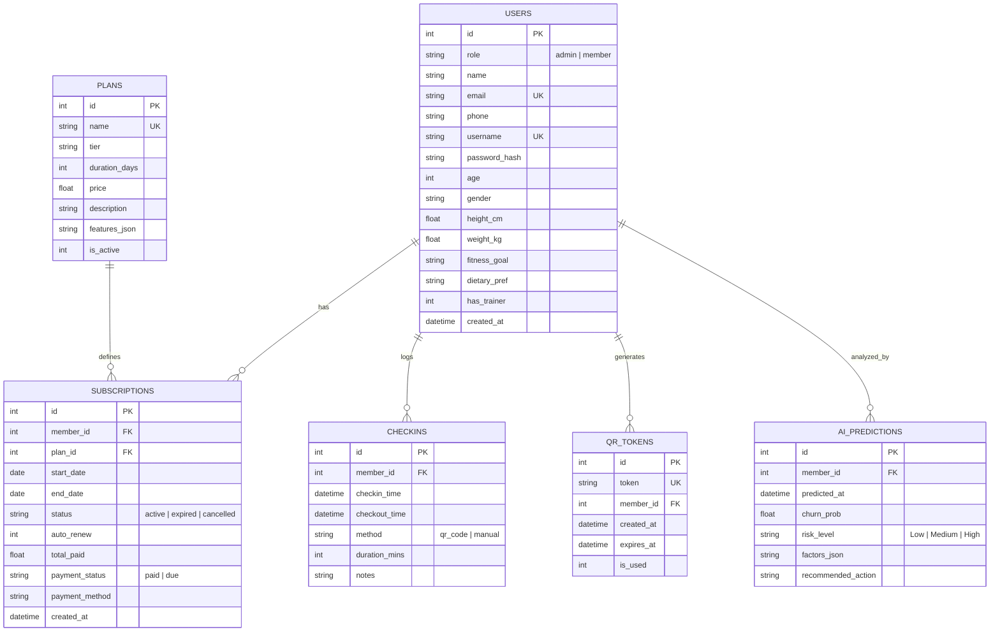
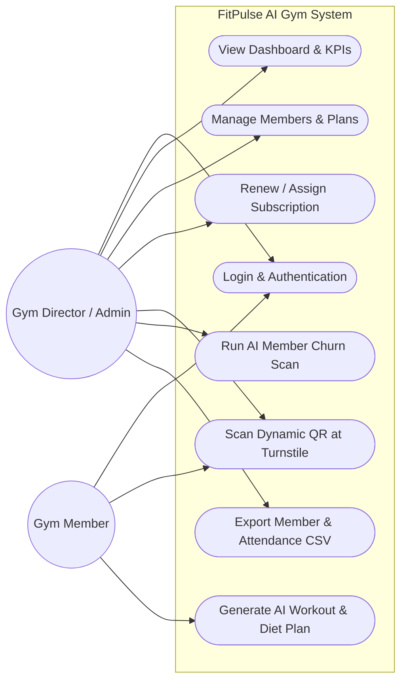
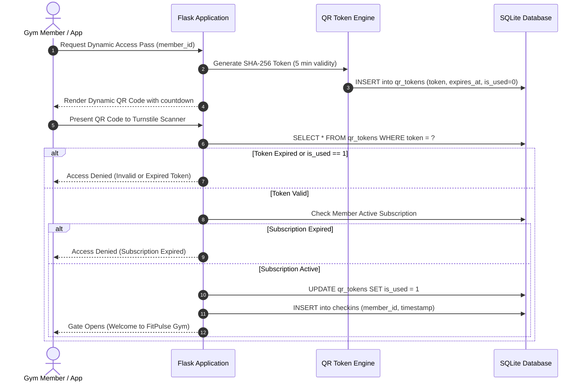
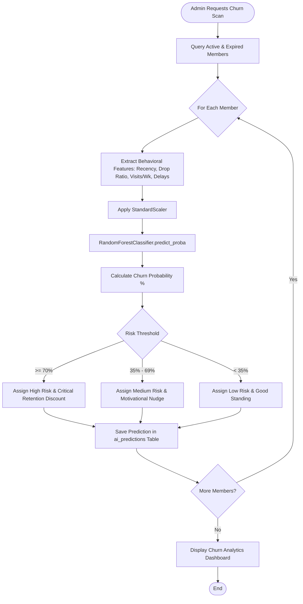
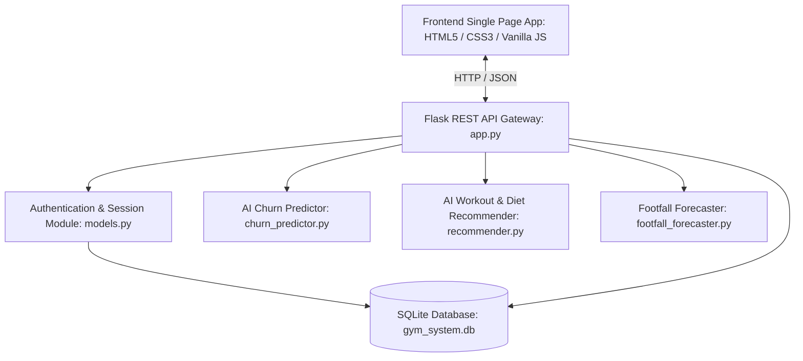

# FitPulse AI — Unified Modeling Language (UML) Diagrams & Architecture

### 1. Entity-Relationship (ER) Diagram

---

### 2. Use Case Diagram

---

### 3. Sequence Diagram (Turnstile Dynamic QR Check-in)

---

### 4. Activity Diagram (AI Member Churn Prediction)

---

### 5. Component Diagram

